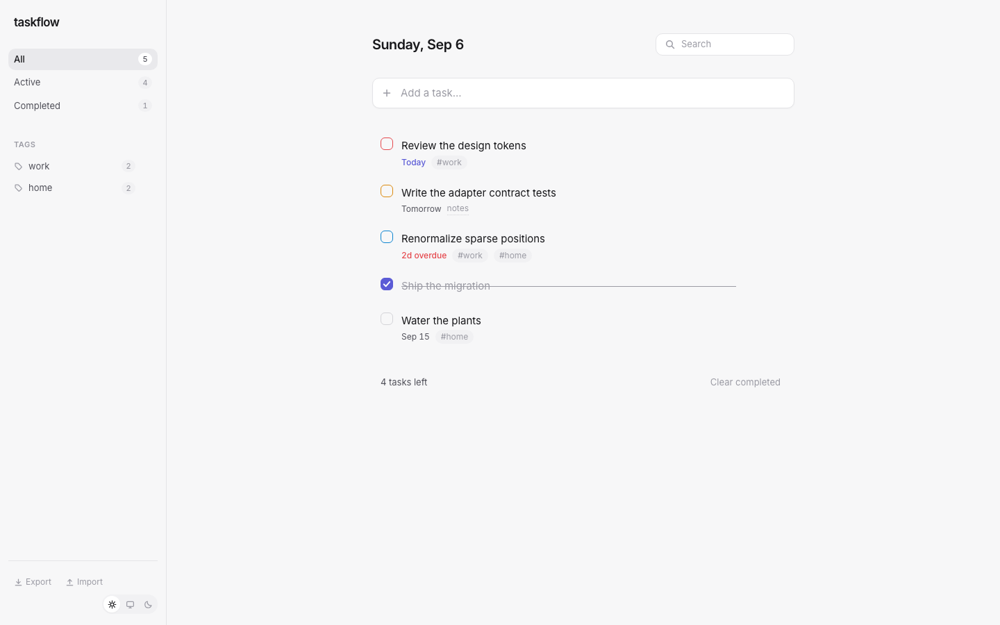
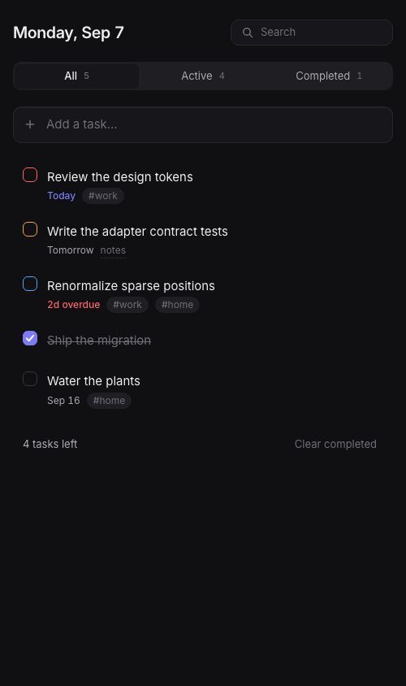
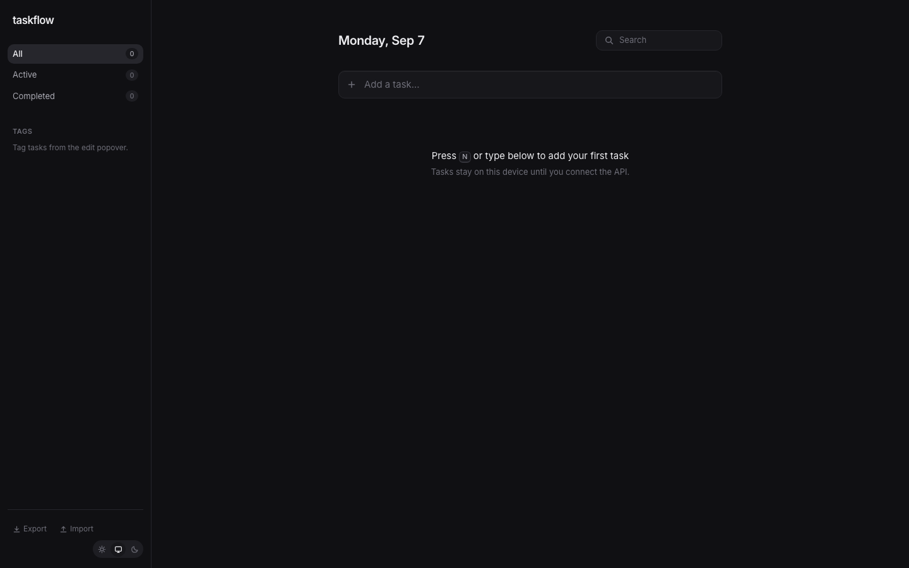

# Taskflow

A production-grade task manager, rebuilt from a vanilla-JS TODO app into a React +
TypeScript frontend and a Spring Boot + MySQL backend — with one canonical data model
across every layer, so switching persistence from the browser's localStorage to MySQL
is a config flip and a JSON import, not a rewrite.



| Dark theme (mobile) | Completing a task |
| --- | --- |
|  |  |

## Features

- Task CRUD with a QuickAdd composer (priority, due date, and tags revealed on focus)
  and instant inline title editing
- Animated complete toggle — SVG stroke-draw check, strikethrough sweep, counter tick —
  backed by a `completedAt` timestamp
- Priorities (`NONE/LOW/MEDIUM/HIGH`) shown as a checkbox border tint
- Due dates with relative labels (Today / Tomorrow / Fri / Sep 12), overdue highlighting,
  and a hand-built month-grid date picker
- All / Active / Completed filters with live counts, plus debounced text search
- Drag-and-drop reordering (@dnd-kit) with a keyboard fallback, persisted as sparse
  integer positions
- Tags: colored `#name` chips on rows, sidebar tag filters, managed in the edit popover
- Notes field and a single task-edit popover for all metadata
- Clear completed and delete with a 5-second undo toast — no confirm dialogs
- Keyboard shortcuts: `N` new, `/` search, arrows to navigate, `E` edit, `D` toggle done,
  `Backspace` delete, `0–3` priority, `Alt+Arrow` reorder
- Light / dark / system theme with a pre-paint script (no flash) and a hand-tuned dark palette
- JSON import/export — also the localStorage → MySQL migration handoff
- Multi-tab safe: localStorage mode reconciles via the `storage` event
- Automatic one-time migration of data from the legacy vanilla app (the old key is never
  modified, so rollback is always possible)

## Tech stack

**Frontend** — Vite 6, React 19, TypeScript (strict), Zustand, @dnd-kit, CSS Modules with
a design-token system (no UI kit, no Tailwind). Tests: Vitest, Testing Library, MSW.

**Backend** — Spring Boot 3.5.3 (Java 21, Gradle), Spring Data JPA, Flyway-managed MySQL 8.4
schema, springdoc OpenAPI (Swagger UI), RFC 9457 `problem+json` errors.
Tests: Testcontainers MySQL integration suite.

## Quickstart (frontend only — the default)

No backend or database needed; tasks persist in your browser's localStorage.

```bash
cd frontend
npm install
npm run dev        # → http://localhost:5173
```

## Full-stack mode (MySQL via the REST API)

1. Start MySQL (Docker required):

   ```bash
   docker compose up -d
   ```

   The compose file honors a `MYSQL_PORT` env var (default `3306`) if that port is taken:
   `MYSQL_PORT=3307 docker compose up -d`.

2. Start the API (Flyway creates the schema and seeds the local user):

   ```bash
   cd backend
   ./gradlew bootRun          # → http://localhost:8080  (prefix with MYSQL_PORT=3307 if overridden)
   ```

   Swagger UI: `http://localhost:8080/swagger-ui.html`.

3. Point the frontend at the API — edit `frontend/.env`:

   ```
   VITE_STORAGE_MODE=api
   VITE_API_BASE_URL=http://localhost:8080/api/v1
   ```

   Restart `npm run dev`.

### Moving your localStorage data to MySQL

Both storage modes speak the same versioned JSON envelope
(`{ schemaVersion: 2, tasks, tags }`), so migration is an export/import round-trip:

1. While still in local mode, use **Export** in the sidebar footer to download your data.
2. Switch to API mode (steps above).
3. Use **Import** in the sidebar footer (or `POST /api/v1/import`) — a transactional
   upsert-by-id; existing rows are skipped and counts are reported back.

Because task ids are client-generated UUIDs, they survive the move unchanged. Your
localStorage copy is left intact as a backup.

## Testing

```bash
cd frontend && npm run test      # 75 Vitest tests — including a shared adapter contract
                                 # suite run against BOTH storage adapters (API via MSW),
                                 # plus migration and position-math suites

cd backend && ./gradlew test     # 33 integration tests on Testcontainers MySQL (Docker
                                 # must be running) — full REST contract, error shapes,
                                 # and an exact-JSON serialization check
```

## Project structure

```
TODO/
├── frontend/                 # Vite + React + TS app
│   └── src/
│       ├── domain/           # types, validation, position math, date logic (pure)
│       ├── storage/          # StorageAdapter interface, LocalStorage & Api adapters, migration
│       ├── store/            # Zustand store, selectors, undo
│       ├── features/         # tasks, filters, theme
│       ├── components/       # Button, Popover, DatePicker, Toast, ...
│       └── test/             # adapter contract, migration, position suites
├── backend/                  # Spring Boot REST API
│   └── src/main/java/com/chetanwanave/todo/
│       ├── controller/ service/ repository/ entity/ dto/ mapper/ exception/ config/
│       └── resources/db/migration/V1__init.sql   # Flyway-owned schema
├── legacy/                   # the original vanilla-JS app (read-only)
├── SPEC.md                   # single source of truth: data model, API contract, visual spec
├── schema.sql                # canonical DDL (identical copy of V1__init.sql)
└── docker-compose.yml        # dev MySQL 8.4
```

## API at a glance

Base `/api/v1` · JSON camelCase · UUID string ids · RFC 9457 errors.
`GET/POST /tasks`, `GET/PATCH/DELETE /tasks/{id}`, `PUT /tasks/positions` (batch reorder),
`POST /tasks/clear-completed`, `GET/POST/PATCH/DELETE /tags…`, `GET /export`,
`POST /import`, `GET /health`. Full contract in [SPEC.md](SPEC.md).

rabbit
tiger
