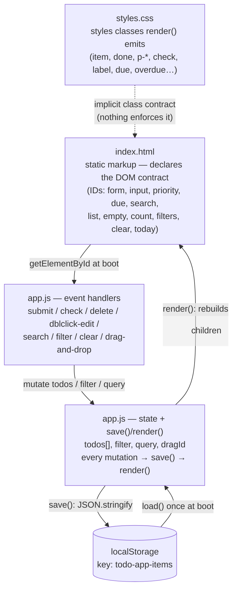

# Architecture — TODO App (September 2026)

> **Superseded:** this documents the legacy vanilla-JS app, now archived in `legacy/`.
> The production rebuild (React + Spring Boot) is specified in `SPEC.md`.

A vanilla HTML/CSS/JS TODO app. No framework, no build step, no server: three
source files served as-is, with `localStorage` as the only persistence.

## Component sketch



ASCII fallback (same picture):

```
 index.html ──(IDs looked up at boot)──▶ app.js handlers ──▶ app.js state
     ▲                                                          │    ▲
     │ render() rebuilds <ul>                          save()   │    │ load()
     │                                                          ▼    │ (boot)
 styles.css ◀┄(implicit class contract)┄ DOM          localStorage["todo-app-items"]
```

**Components (4 + 1 external store):**

1. **`index.html`** — static shell only (no inline script/style). Its real job is
   declaring the DOM contract: the element IDs `app.js` grabs at boot.
2. **`app.js` — event handlers** — submit (add), check (toggle), delete,
   double-click (inline edit), search input, filter buttons, clear-completed, and
   HTML5 drag-and-drop reordering. Each one mutates state then calls `save(); render();`.
3. **`app.js` — state + `save()`/`render()`** — module-level `todos` array plus
   `filter`, `query`, `dragId`. `render()` (app.js:45) is a full re-render: clears
   the `<ul>` and rebuilds visible items from state through the filter + search
   predicates. Task text always goes through `textContent`, never `innerHTML` (XSS-safe).
4. **`styles.css`** — all styling; colors as CSS custom properties on `:root` with a
   `prefers-color-scheme: dark` override.
5. **`localStorage`** (external) — the whole `todos` array serialized as JSON under
   `todo-app-items`. Read once at boot, rewritten on every mutation.

**Cross-component dependency worth knowing:** the three files are coupled by an
*implicit string contract* — `app.js` looks up IDs that only `index.html` defines,
and emits class names (`item`, `done`, `p-high`, `overdue`, `dragging`, …) that only
`styles.css` gives meaning. Rename any side and nothing errors; the feature just
silently stops working. This is the app's main architectural risk.

## Data flow: adding a todo (end-to-end)

1. User submits the form → `submit` handler (app.js:155) calls `preventDefault()`.
2. Input text is trimmed; empty text is rejected (early return).
3. New todo is `unshift`ed to the front of `todos`:
   `{ id: Date.now(), text, done: false, priority, due: due.value || null }`.
4. Form fields reset, then `save()` → `JSON.stringify(todos)` into
   `localStorage["todo-app-items"]`.
5. `render()` clears the `<ul>`, filters todos through the active filter
   ('all' | 'active' | 'completed') **and** the search query, and rebuilds one
   `<li>` per visible todo with `createElement`/`textContent` — attaching per-item
   listeners (toggle, edit, delete, drag) as it goes.
6. Count text and empty-state visibility update; focus returns to the input.

## Error path: storage failure

- **Malformed data at boot** — `load()` (app.js:22) wraps `JSON.parse` in
  try/catch and falls back to `[]`. Graceful (app still boots), but *silent data
  loss*: corrupted JSON discards every saved task with no message, and the next
  `save()` overwrites it permanently.
- **Write failure** — `save()` (app.js:26) has **no** error handling. If
  `localStorage.setItem` throws (`QuotaExceededError`, Safari private mode,
  storage disabled), the exception propagates out of the event handler. Because
  every mutation site calls `save(); render();` in that order, `render()` never
  runs: the UI freezes on the pre-mutation view while in-memory state has already
  changed, and the change is gone on refresh. The asymmetry with the defensive
  `load()` is the notable gap.
- **No backend/network** to fail — localStorage is the only dependency, so the two
  cases above are the complete failure surface.

## What exploration surfaced beyond the docs

- **The code has outgrown CLAUDE.md.** The doc describes stored shape
  `{ id, text, done }` and eight element IDs; the actual app also has **priority,
  due dates (with overdue highlighting), search, and drag-and-drop reordering** —
  real shape `{ id, text, done, priority, due }`, plus IDs `priority`, `due`,
  `search` and classes `p-high/p-medium/p-low`, `due`, `overdue`, `dragging`.
- **Likeliest confusion points:** the invisible ID/class contract (nothing tells
  you it exists until something silently breaks), and `render()` doing filtering,
  searching, date formatting, and DOM construction in one ~90-line function.

## Technical debt (one item, for the cohort)

**Stale CLAUDE.md contract.** The doc explicitly promises "keep the shape stable /
handle old shapes" and enumerates the DOM contract, yet the code already ships a
different shape and extra IDs — it's debt rather than mere unfamiliarity because
the documentation makes a promise the code has broken, so anyone trusting the doc
will write wrong code.

*Runner-up:* `save()`'s missing error handling (see the error path above) — one
try/catch away from failing loudly instead of corrupting the session silently.
